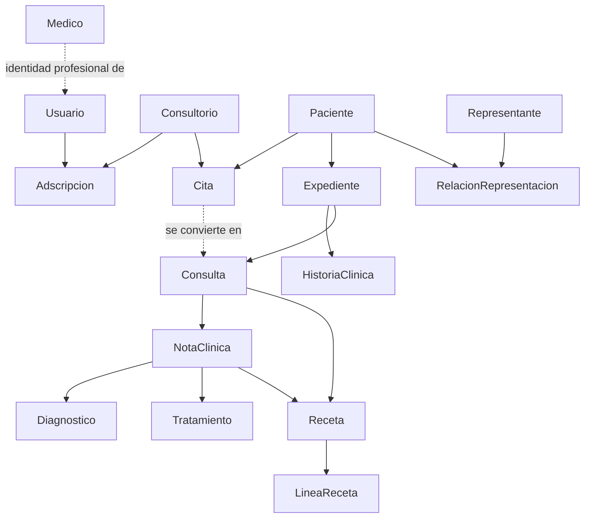

# Modelo de dominio — MVP clínico ambulatorio México

**Fase 6 · Corte 28-08-2026 · Revisión con Cita y rol administrativo**  
Alcance: atención ambulatoria privada para médicos independientes; un médico puede operar en varios consultorios. Cobro y facturación no pertenecen al núcleo clínico (los pagos, cuando se definan, son responsabilidad del rol administrativo, sin diseño detallado todavía).

## 1. Principios del dominio

- El **expediente** es el contenedor longitudinal único del paciente; no es una nota ni una consulta.
- Una **cita** es la reserva/solicitud de atención, previa al encuentro clínico; puede no existir (caso walk-in).
- Una **consulta** representa el encuentro clínico real en un consultorio, atendido por un médico; puede originarse desde una cita convertida o crearse directamente (walk-in).
- Una **nota clínica** documenta la consulta; puede iniciar como borrador y, al finalizarse, se vuelve inalterable.
- Una **receta** es un documento clínico vinculado a una consulta y a su nota; se genera digitalmente, se imprime y se firma autógrafamente.
- Ningún documento final se edita o borra: una corrección se materializa como **adenda**; una receta nueva como **sustitución**.
- Las categorías controladas están prohibidas en el MVP: estupefacientes, psicotrópicos II–IV, cannabis y escenarios especiales.
- El sistema distingue entre **operación administrativa** (agenda, alta de pacientes, pagos futuros) y **contenido clínico** (nota, diagnóstico, tratamiento, receta, historia clínica). Un usuario con rol administrativo puede operar la primera; nunca la segunda, sin excepción de UI ni de API.

## 2. Entidades y atributos mínimos

| Entidad | Propósito | Atributos esenciales |
|---|---|---|
| Médico | Profesional responsable de actos clínicos | id, nombre completo, cédula profesional, cédula especialidad (si se ostenta), estado de verificación |
| Usuario | Identidad que accede al sistema (médico o personal administrativo) | id, **tipo** (Médico \| Administrativo \| AdministradorSistema \| Soporte), médicoId (**solo si tipo = Médico**), nombreCompleto, correo, estado, MFA, último acceso |
| Consultorio | Lugar de atención | id, nombre, domicilio completo, contacto, estado |
| Adscripción | Relación usuario–consultorio (aplica tanto a médicos como a personal administrativo) | usuarioId, consultorioId, rol, vigencia, estado |
| Paciente | Persona atendida | id, nombre, fecha de nacimiento, sexo, CURP validable cuando aplique, contacto |
| Representante | Tutor o representante de menor | id, identidad, contacto, parentesco/mandato, evidencia de verificación |
| RelaciónRepresentación | Autorización paciente menor–representante | pacienteId, representanteId, tipo, vigencia, evidencia, estado |
| **Cita** | **Reserva/solicitud de atención, anterior a la consulta** | **id, pacienteId, consultorioId, médicoId (opcional/preferido), creadaPorUsuarioId, fechaHoraProgramada, motivo (texto libre, opcional/ambiguo permitido), estado** |
| Expediente | Historial clínico longitudinal | id, pacienteId, fecha de apertura, estado, retenciónHasta |
| HistoriaClínica | Antecedentes estructurados | id, expedienteId, versión, contenido estructurado, estado |
| Consulta | Encuentro clínico real | id, expedienteId, **citaId (opcional, nulo si es walk-in)**, médicoId, consultorioId, fechaHora, motivo, estado, registradaPorUsuarioId |
| NotaClínica | Documento clínico de consulta | id, consultaId, tipo, contenido estructurado (ver sección 3), estado, autorId, finalizadaEn, hash |
| Diagnóstico | Hallazgo clínico de consulta/nota | id, notaId, catálogo/código, descripción, tipo |
| Tratamiento | Plan terapéutico no necesariamente farmacológico | id, notaId, indicaciones, vigencia |
| Receta | Documento de prescripción | id, consultaId, notaId, pacienteId, médicoId, estado, emitidaEn, versión, hash |
| LíneaReceta | Medicamento e indicaciones | id, recetaId, genérico, distintivo opcional, presentación, concentración, dosis, vía, frecuencia, duración, cantidad, resurtimientos, clasificación |
| Estudio/Adjunto | Resultado o documento clínico asociado | id, expedienteId, consultaId opcional, tipo, referencia segura, autorId, estado |
| Referencia | Canalización a otro profesional/servicio | id, consultaId, destinatario, motivo, indicaciones, estado |
| Firma/Constancia | Evidencia del cierre documental | id, documentoTipo, documentoId, autorId, mecanismo, fechaHora, evidencia; para receta MVP: constancia de impresión/firma autógrafa |
| Auditoría | Registro transversal de eventos | id, actorId, acción, recursoTipo, recursoId, fechaHora, origen, antes/después, correlación |

**Cambios respecto a la versión anterior de este documento:**

1. Se agrega la entidad **Cita**, separada de **Consulta** (ver sección 10 para la justificación completa).
2. `AdscripciónMédico` se generaliza a **Adscripción** (usuario–consultorio), porque ahora también el personal administrativo necesita estar adscrito a uno o más consultorios para que aplique el control de "negar por defecto" de Fase 7.
3. `Usuario` deja de asumir que todo usuario es un médico: se agrega `tipo`, y `médicoId` pasa a ser condicional.
4. `Consulta` agrega `citaId` opcional, para enlazar con la cita que la originó cuando exista, y `registradaPorUsuarioId`, porque ahora quien crea la consulta puede ser personal administrativo (check-in) y no necesariamente el médico.

**Nota importante sobre "Resumen Clínico":** no es una entidad ni un campo de captura de `NotaClínica`. Es un documento distinto, generado a partir de una o varias notas ya finalizadas (RF-013 del análisis NOM-004: "generar un resumen clínico con padecimiento actual, diagnósticos, tratamientos, evolución, pronóstico y estudios relevantes"), típicamente para acompañar una referencia a otro profesional. No existe todavía como entidad en esta tabla porque su diseño queda pendiente para cuando se aborde el flujo de Referencia en Fase 8/9.

## 3. Esquema de contenido estructurado — NotaClínica

**Origen de esta aclaración:** las pantallas de UI ya prototipadas (`Prompts_ClaudeDesign_Pantallas_Sistema_Consultas`) incluían por error un campo "motivo" y un campo "resumen clínico" dentro del formulario de la nota, como si fueran parte de su contenido propio. Esta sección fija el esquema correcto, basado en los numerales DAT-034 a DAT-040 del análisis de NOM-004 (nota de evolución ambulatoria), y corrige ambos errores.

| Campo | Fuente NOM-004 | Obligatorio en MVP | Tipo de dato | Nota |
|---|---|---|---|---|
| Motivo de consulta | No es un campo de la nota — es el atributo `motivo` de `Consulta` (heredado, a su vez, de `Cita` cuando existe) | No aplica (no se captura aquí) | — | Se muestra **heredado y de solo lectura** en el encabezado de contexto de la nota, únicamente para dar referencia. El único lugar donde se edita es la pantalla de la consulta. |
| Evolución / padecimiento actual | DAT-034 | Sí | texto largo | Reemplaza el campo mal etiquetado "resumen clínico" en las pantallas actuales; es la narrativa propia de esta consulta, no el documento "Resumen Clínico". |
| Signos vitales | DAT-035 ("cuando sean necesarios") | Condicional | grupo numérico: TA, FC, FR, temperatura, peso, talla | No debe bloquear la finalización si no aplica clínicamente a la consulta. |
| Estudios relevantes | DAT-036 | Condicional | referencia a `Estudio/Adjunto` existente | Se vincula a un adjunto ya cargado; no se recaptura contenido aquí. |
| Diagnóstico(s) / problemas clínicos | DAT-037; RF-017 | Sí (uno o más) | lista estructurada (catálogo/código + descripción) | Vinculado a la entidad `Diagnóstico` ya presente en el modelo. |
| Pronóstico | DAT-038 | Sí según el texto literal de la norma — **decisión de producto pendiente** (ver abajo) | selección corta (p. ej. bueno/reservado/malo) + nota opcional | No estaba contemplado en la lista original del usuario; hay que decidir conscientemente si se incluye tal cual o se simplifica. |
| Tratamiento / indicaciones | DAT-039–040; RF-018 | Sí | lista estructurada o texto | Vinculado a la entidad `Tratamiento`; no implica necesariamente una receta. |

**Metadatos que no se capturan manualmente** (se asignan automáticamente por el sistema, no son campos del formulario): autor (usuario autenticado), fecha/hora (tiempo de servidor, UTC), paciente y consulta asociada (heredados de la consulta activa). Ver RF-004, RF-005, RF-006 del análisis NOM-004.

**Decisión pendiente — Pronóstico:** la norma lo lista sin marcarlo como condicional, a diferencia de signos vitales ("cuando sean necesarios") o estudios ("relevantes"). Tratarlo como obligatorio en el MVP es la lectura conservadora del texto, pero puede generar fricción en consultas breves y rutinarias. Recomendación: si se conserva obligatorio, ofrecerlo como una selección de opciones predefinidas de captura rápida en vez de texto libre, para no penalizar la velocidad de captura. Esta decisión debe quedar registrada explícitamente antes de construir la pantalla de nota clínica (Fase 8), no dejarse implícita.

## 4. Relaciones

## 5. Estados y reglas de ciclo de vida

| Agregado | Estados | Reglas |
|---|---|---|
| **Cita** | **Agendada → Confirmada (opcional) → Convertida en Consulta \| Cancelada \| No presentado** | **Puede crearla/editarla/cancelarla un usuario con rol Médico o Administrativo, dentro de su adscripción activa al consultorio. El motivo es de texto libre y puede quedar ambiguo o vacío — no se valida clínicamente en este punto. "Convertida en Consulta" es una transición, no un estado final: una vez convertida, el seguimiento pasa a vivir en la Consulta.** |
| Nota clínica / historia | Borrador → Finalizada → Corregida por adenda | Sólo el autor autorizado edita borrador. Finalizar fija versión, hash, autor y fecha/hora. Adenda no reabre ni altera la original. |
| Receta | Borrador → Lista para emitir → Emitida/fijada → Anulada o Sustituida → Vencida | Validar paciente, médico, consulta, nota y líneas antes de emitir. Emitida es un snapshot inmutable. Anulación conserva motivo; sustitución enlaza ambas recetas. |
| Consulta | Abierta → Cerrada | Sólo puede cerrarse con nota finalizada o con causa documentada. Puede crearla un usuario Médico o Administrativo (check-in desde cita, o registro directo de walk-in); una vez creada, sólo un Médico puede iniciar o editar la nota clínica asociada. |
| Representación | Pendiente → Verificada → Revocada/Vencida | Para menores, no permitir atención clínica sin representante verificable, salvo flujo de excepción jurídicamente definido. |

## 6. Reglas de negocio P0

1. Todo paciente tiene un solo expediente lógico; las consultas se agregan a éste.
2. La consulta requiere médico, consultorio, paciente y fecha/hora. El motivo es recomendable capturarlo desde la creación (heredado de la cita si existe), pero no bloquea la creación de la consulta si llega vacío o ambiguo.
3. Una receta sólo puede emitirse desde una consulta con nota clínica finalizada.
4. Una receta exige datos del paciente, médico/cédula, consultorio, fecha, genérico y pauta completa.
5. El sistema deniega cualquier línea de receta clasificada como controlada o excluida.
6. Antibióticos exigen cantidad y duración; el estado "dispensada" no existe sin evidencia externa verificable y queda fuera del MVP.
7. No se elimina contenido clínico ni receta emitida; se retiene y audita conforme al backlog.
8. Toda lectura, creación, finalización, emisión, descarga, impresión, anulación y exportación genera auditoría.
9. La firma autógrafa ocurre fuera del sistema sobre la impresión; el sistema registra emisión/impresión, pero no declara dispensación ni validez universal.
10. Un usuario con rol Administrativo puede crear y gestionar citas, dar de alta/editar pacientes y registrar el check-in que crea una consulta — nunca puede crear, leer, editar, finalizar o exportar contenido clínico (nota, diagnóstico, tratamiento, historia clínica, receta). Esta restricción se aplica en autorización (backend), no solo se oculta en la interfaz.
11. Un usuario con rol Médico tiene acceso funcional completo (citas, pacientes, clínico, y pagos cuando se definan) **dentro de sus consultorios adscritos activos** — "sin restricciones" se interpreta como alcance funcional completo, no como excepción al control de adscripción por consultorio (US-C1-02), que se mantiene sin excepción para todos los roles.

## 7. Límites explícitos

Fuera de este modelo inicial: hospitalización, urgencias, enfermería, quirófano, facturación/cobro (diseño detallado de pagos pendiente), envío a farmacias, estados de dispensación, integración COFEPRIS, HL7/FHIR, QR y automatización de IA con datos clínicos identificables.

## 8. Aclaración operativa: independencia entre cierre de consulta y finalización de nota

**Origen:** pregunta de producto sobre el escenario "el paciente termina la consulta física y se va — ¿debe quedar la nota finalizada en ese momento?". Ni la NOM-004 ni las historias de usuario de Fase 7 fijan un plazo de captura; la norma exige legibilidad, autoría, fecha/hora y ausencia de alteraciones, pero no un momento obligatorio de finalización. Esta sección documenta la interpretación de producto adoptada, no una obligación normativa literal.

**Regla de diseño:** la consulta y la nota clínica son máquinas de estado **independientes a propósito**.

- El estado físico del encuentro (el paciente se retira) no dispara ningún cambio de estado automático en el sistema.
- La consulta puede permanecer en `Abierta` con su nota todavía en `Borrador` después de que el paciente se fue; esto es esperado en la práctica real (el médico atiende varios pacientes seguidos y documenta después, entre consultas o al final del día).
- La única regla dura ya definida (sección 5) es que la consulta **no puede cerrarse** sin que su nota esté `Finalizada` o sin una causa documentada explícita. Esa regla evita que una consulta quede en un limbo indefinido; no obliga a finalizar la nota en el instante en que el paciente se retira.

**Riesgo a vigilar:** sin ningún mecanismo de visibilidad, los borradores pueden acumularse por días o semanas, lo cual es malo operativamente (el médico pierde detalle) y debilita el valor probatorio de una nota "finalizada" con fecha de finalización muy posterior a la consulta real.

**Recomendación de producto (pendiente de validar en el piloto de Fase 12):**

1. Agregar un indicador operativo, no bloqueante, de "consultas con nota pendiente de finalizar" visible en la agenda — informa sin forzar.
2. No introducir un bloqueo duro por antigüedad de borrador en el MVP, porque no hay una obligación normativa explícita que lo exija y podría generar fricción injustificada; si se decide más adelante, debe ser una política configurable (alerta) validada primero con médicos reales, no un límite fijo de ingeniería.
3. Esta interpretación debe revisarse en la Fase 11 (validación regulatoria) junto con el resto de las reglas derivadas por ingeniería que no están prescritas literalmente por la norma.

## 9. Puente a Fase 7

Los mecanismos transversales que deben construirse antes de formularios clínicos son: autenticación, autorización por relación usuario–consultorio (médico y administrativo), verificación de identidad profesional, auditoría, sello temporal, control de versiones, inmutabilidad, retención, respaldo/recuperación y gestión de firma/constancia de impresión.

## 10. Cita como entidad separada de Consulta, y rol de personal administrativo

**Origen:** decisión de producto tomada a partir del escenario "paciente llega sin cita previa" vs. "paciente con cita agendada donde alguien más captura el motivo". Antes de esta revisión, el modelo no distinguía entre "reservar una atención futura" y "el encuentro clínico en curso" — ambos vivían implícitamente en `Consulta`. Esto generaba dos problemas: no había forma de representar una cita agendada días antes sin ya estar "abriendo" un encuentro clínico, y no existía ningún rol capaz de agendar o dar de alta pacientes sin, al mismo tiempo, tener acceso a `NotaClínica`.

**Decisiones adoptadas:**

1. **`Cita` es una entidad propia**, anterior y opcional a `Consulta`. Se crea al agendar (por teléfono, en el mostrador, o por walk-in inmediato) y se **convierte** en `Consulta` cuando el paciente es recibido y comienza el encuentro real. Una consulta walk-in sin cita previa simplemente nace con `citaId = null`.
2. El campo `motivo` en `Cita` es deliberadamente de baja fricción: texto libre, puede quedar vacío o ambiguo ("consulta general", "no especifica"). No se valida clínicamente — la precisión clínica real se documenta después, en la nota, por el médico. Al convertir la cita en consulta, el motivo se copia/hereda; el médico puede corregirlo libremente mientras la consulta siga `Abierta`, sin ninguna restricción de inmutabilidad (esa solo aplica a los documentos clínicos, nunca a `Cita` ni a `Consulta`).
3. **Nuevo rol: Administrativo.** Puede agendar, confirmar, reprogramar y cancelar citas; dar de alta y editar datos generales de pacientes; registrar el check-in de una cita o crear una consulta walk-in directamente; y, cuando se diseñe, gestionar cobros. **Nunca** puede crear, leer, editar, finalizar ni exportar contenido clínico — nota, diagnóstico, tratamiento, historia clínica o receta —, sin excepción, aplicado a nivel de autorización backend, no solo ocultando botones en la UI.
4. **El rol Médico conserva acceso funcional completo** (todo lo que hace Administrativo, más lo clínico) — pero siempre **dentro de sus consultorios adscritos activos**. La frase "sin restricciones" se interpretó como alcance funcional completo, no como excepción al control de "negar por defecto" por adscripción de US-C1-02; esa regla de seguridad no se relaja para ningún rol. **Esta interpretación queda señalada explícitamente para tu confirmación** — si la intención era otra (por ejemplo, que un médico vea pacientes de consultorios donde no tiene adscripción activa), es una desviación importante del diseño de Fase 7 y debe decidirse con esa consecuencia clara.
5. Para sostener esto, `AdscripciónMédico` se generalizó a **`Adscripción`** (usuario–consultorio), y `Usuario` dejó de asumir que todo usuario es un médico.

**Impacto en trabajo ya entregado, pendiente de actualizar:**

- El prompt de la Pantalla 1 (agenda) debería distinguir, o al menos filtrar, entre citas agendadas y consultas ya en curso — hoy mezcla el concepto.
- Falta diseñar al menos dos pantallas nuevas: "Agendar/crear cita" y "Check-in / convertir cita en consulta" (o "Registrar consulta walk-in").
- La Historia de Usuario US-C1-03 ("Gestión de adscripciones"), originalmente escrita en términos de médico–consultorio, debería generalizarse a usuario–consultorio para cubrir también al personal administrativo. No se modificó todavía el documento de historias de usuario de Fase 7; queda pendiente si se desea actualizarlo.
