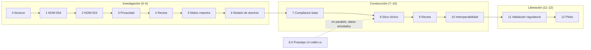

# Roadmap de entrega por fases

**Corte:** 22-10-2026 · Fuente: `Ruta.md` (ruta de investigación y construcción del MVP).

`Ruta.md` define la secuencia completa. Este documento la convierte en un plan de entrega: qué sale en cada fase de construcción, de qué depende y cómo se sabe que terminó. Cada fase de construcción tiene su propio documento `fase-NN-*.md`, hecho a partir de `_plantilla-fase.md`.

## Vista general

## Estado por fase

| Fase | Nombre | Entregable | Estado | Documento |
|---|---|---|---|---|
| 0 | Alcance del MVP | Documento de alcance | ✅ Cerrada | `Ruta.md` |
| 1 | NOM-004 | Matriz de requisitos NOM-004 | ✅ Cerrada | `Analisis_NOM-004-SSA3-2012_Requisitos_Software.docx` |
| 2 | NOM-024 | Matriz de requisitos NOM-024 | ✅ Cerrada | `Analisis_NOM-024-SSA3-2012.docx` |
| 3 | Privacidad | Matriz P3-001..040 | ✅ Cerrada (7 DEC pendientes) | `Cierre_Fase_3_Privacidad.md` |
| 4 | Receta electrónica | Matriz regulatoria de receta | ✅ Investigada | `Investigacion_Receta_Electronica_MVP_Mexico.docx` |
| 5 | Matriz maestra | Backlog regulatorio maestro | ✅ Cerrada | `Backlog_Regulatorio_Maestro_MVP_Mexico.md` |
| 6 | Modelo de dominio | Modelo de dominio y diseño de BD | ✅ Cerrada (DEC-DOM-003 y DEC-PRD-001 pendientes) | `Modelo_de_Dominio…`, `Diseno_Base_de_Datos…` |
| 7 | Infraestructura de compliance | Auth/MFA, RBAC + RLS, auditoría, inmutabilidad, retención, respaldos | 🟡 Diseñada, sin construir | `fase-07-compliance.md` |
| 8.0 | Prototipo de UI | Pantallas P1–P10 navegables, con datos simulados | 🔵 En curso (colibri-ui) | `fase-08-vertical-slice-clinico.md` |
| 8 | Vertical slice clínico | Paciente → cita → consulta → nota → finalizar → historial | ⚪ Por iniciar (depende de la 7) | `fase-08-vertical-slice-clinico.md` |
| 9 | Receta | Módulo mínimo de receta | ⚪ Por iniciar | `fase-09-receta.md` (por crear) |
| 10 | Interoperabilidad | Estrategia de interoperabilidad | ⚪ Por iniciar | — |
| 11 | Validación regulatoria | Matriz de cumplimiento validada | ⚪ | `trazabilidad.md` |
| 12 | Piloto | Resultados del piloto con médicos | ⚪ | — |

Leyenda: ✅ cerrada · 🟡 diseñada · 🔵 en curso · ⚪ no iniciada

## Fases de construcción en detalle

### Fase 7 — Infraestructura de compliance

- **Objetivo:** que ningún dato clínico pueda existir sin identidad, autorización por consultorio, auditoría e inmutabilidad.
- **Incluye:** US-C1-01..03, US-C2-01..02, US-C3-01..03, US-C4-01..05.
- **No incluye:** pantallas clínicas, receta ni cobros.
- **Depende de:** DEC-ARQ-005 (proveedor de MFA), DEC-P3-001 (tenant), DEC-PEND-006 (rol de cumplimiento) y DEC-PEND-001 (cálculo de retención).
- **Criterio de salida:** los 6 criterios de `Infraestructura_Base_de_Compliance_MVP`, más las pruebas negativas del rol Administrativo sobre todos los endpoints clínicos.
- **Sprints:** 1) identidad y RBAC · 2) auditoría y tiempo · 3) finalizar y adenda · 4) retención, respaldos, aviso e incidentes · 5) exportación de auditoría y ARCO.

### Fase 8.0 — Prototipo de UI (en paralelo)

- **Objetivo:** validar los flujos y la experiencia de P1–P10 antes de conectar el backend.
- **Restricción:** solo datos simulados (IndexedDB local). **Nunca datos de pacientes reales** (RN-GEN-007).
- **Salida:** todas las pantallas navegables; las reglas de UI (RN con capa **UI**) visibles y probadas; los cambios de diseño, registrados.
- **Riesgo:** que la UI invente reglas que no estén en el catálogo. Cada validación que se agregue en el frontend debe citar un RN.

### Fase 8 — Vertical slice clínico

- **Objetivo:** un flujo completo de punta a punta sobre la infraestructura de la Fase 7.
- **Flujo:** registrar paciente → agendar cita / walk-in → registrar llegada → iniciar nota → diagnóstico y tratamiento → finalizar → adenda → cerrar consulta → consultar historial.
- **Depende de:** la Fase 7 cerrada; DEC-PRD-001 (pronóstico) y DEC-PEND-002/-003/-004/-007/-008.
- **Criterio de salida:** el flujo funciona con dos roles (Médico y Administrativo), con todas las RN de la fase cubiertas por pruebas y el evento de auditoría de cada paso verificado.

### Fase 9 — Receta

- **Objetivo:** emitir, imprimir, anular y sustituir recetas ordinarias desde una nota finalizada.
- **Depende de:** la Fase 8; el catálogo de medicamentos (RX-002); DEC-P3-003; DEC-PEND-005 (vigencia).
- **Criterio de salida:** no se puede emitir ninguna receta de una categoría excluida por ninguna vía (criterio 2 de la Fase 5), y existe una receta de prueba con su evidencia.

### Fases 10–12

Las fases 10 a 12 se planean cuando la 9 esté cerrada. Antes de la 11, `trazabilidad.md` debe tener evidencia en cada fila P0.

### Hito bloqueante de venta — e.firma (después del MVP)

- **Prioridad:** alta. **Ningún cliente real contrata el producto hasta cerrar este hito** (RN-GEN-008, DEC-ARQ-007).
- **Objetivo:** que notas clínicas y adendas se firmen con firma electrónica avanzada verificable, en lugar del respaldo MFA + hash del MVP (RN-NOT-010).
- **Alcance propuesto:** e.firma del SAT como mecanismo principal (`fea_sat`), con un PSC acreditado como alternativa (`fea_psc`). La firma se aplica en el navegador sobre el hash del snapshot; la llave privada nunca sale del equipo del médico. El servidor valida la firma, la cadena del certificado, su vigencia y revocación, y que el RFC coincida con el del médico. Requiere `RFC` en `medico` y firmar también las adendas.
- **No incluye:** la receta, que conserva su propio marco (DEC-RX-001).
- **Depende de:** Fase 7 (mecanismo extensible en `firma_constancia`) y validación jurídica de la firma.
- **Criterio de salida:** una nota y una adenda firmadas con e.firma se verifican de forma independiente, con evidencia archivada en `trazabilidad.md`.
- **Estado:** ⚪ por iniciar. No tiene fase numerada todavía; asignarle una antes de la Fase 11.

## Reglas de este roadmap

1. Una fase no se cierra sin cumplir su **Definition of Done** (`definition-of-done.md`).
2. Las decisiones **Pendientes** que bloquean una fase se resuelven antes de iniciarla, no durante ella.
3. Al cerrar una fase se agrega una entrada en `bitacora-fases.md`.
4. No se comercializa ninguna versión antes de cerrar el hito de e.firma (RN-GEN-008).
