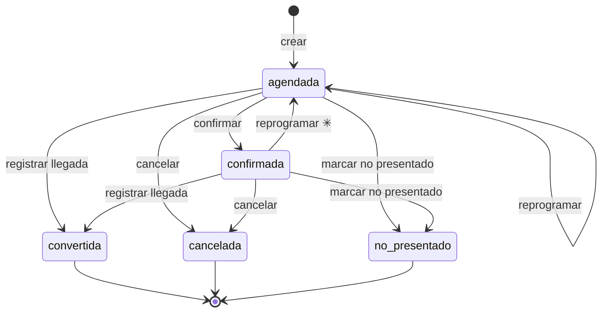
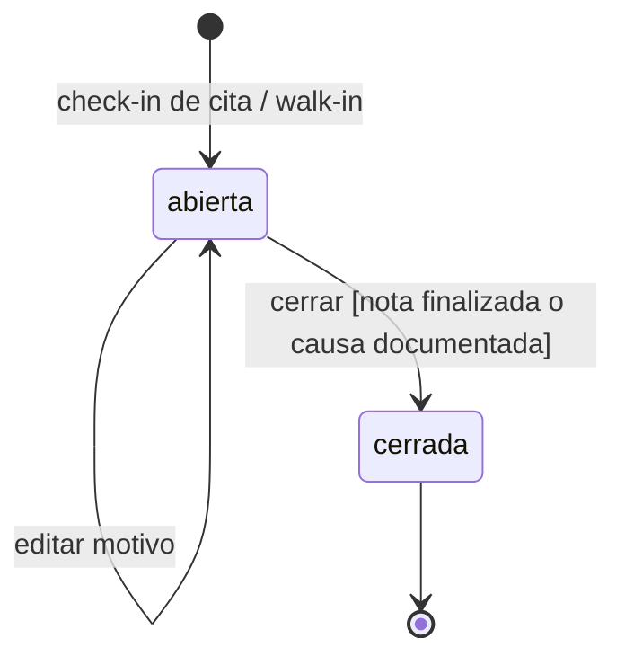
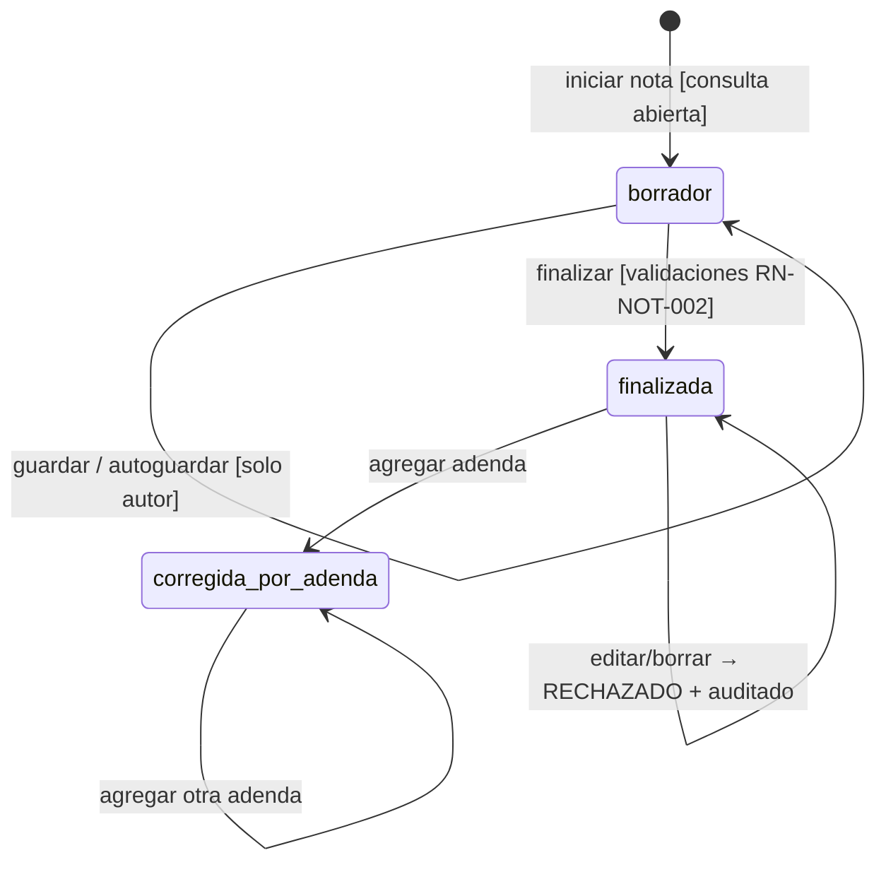
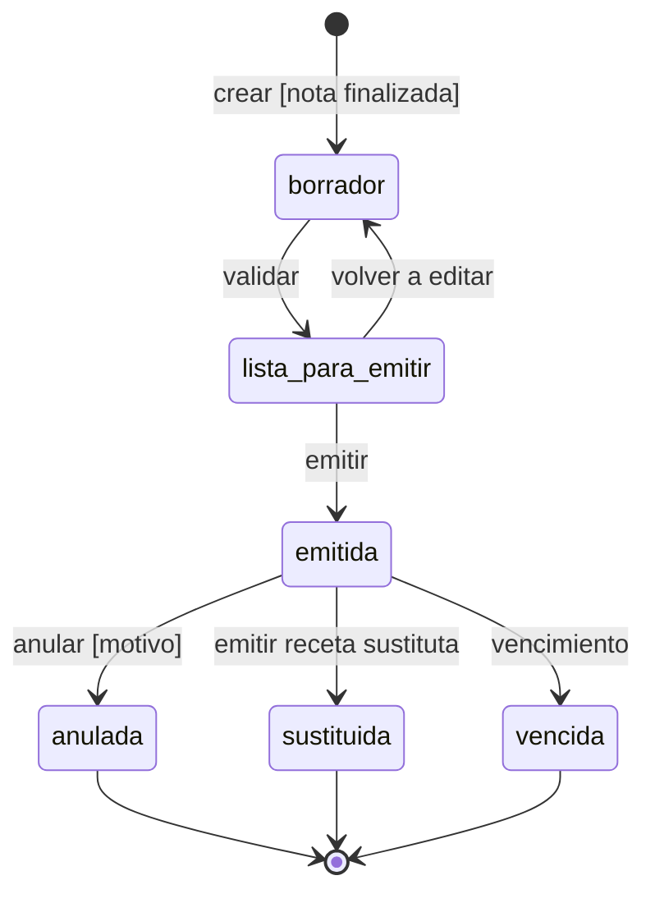

# Ciclos de vida de las entidades

**Corte:** 22-10-2026 · Complementa a `01-catalogo-reglas-negocio.md`.

Para cada entidad con estados se definen el diagrama, las transiciones permitidas, quién puede ejecutarlas, las condiciones (guardas) y los efectos. **Cualquier transición que no aparezca aquí está prohibida** y la API debe rechazarla (y auditar el rechazo cuando el recurso sea clínico).

Los valores de estado coinciden con los `CHECK` de `Diseno_Base_de_Datos_MVP_Clinico_Mexico` (columna `estado`).

Convenciones: **M** = Médico · **A** = Administrativo · **AS** = Administrador de sistema · **RC** = Responsable de cumplimiento · ✳ = transición propuesta por ingeniería, pendiente de confirmar.

---

## 1. Cita

| Desde | Hacia | Acción | Quién | Guardas | Efectos | Regla |
|---|---|---|---|---|---|---|
| — | agendada | Crear cita | M, A | Adscripción activa al consultorio; paciente, consultorio y fecha/hora presentes | Auditoría `cita.creada` | RN-CIT-001, -003 |
| agendada | confirmada | Confirmar | M, A | — | `cita.confirmada` | RN-CIT-003 |
| agendada / confirmada | agendada | Reprogramar | M, A | Nueva fecha/hora | Se cambia la fecha; una cita confirmada vuelve a `agendada` ✳; `cita.reprogramada` | RN-CIT-003 |
| agendada / confirmada | convertida | Registrar llegada (check-in) | M, A | Paciente sin menor bloqueado (RN-PAC-006); la cita no tiene consulta todavía | Crea la **Consulta** en la misma transacción, con `cita_id` y el motivo heredado; `cita.convertida` + `consulta.creada` | RN-CON-002, RN-CIT-005, -006 |
| agendada / confirmada | cancelada | Cancelar | M, A | Motivo de cancelación opcional ✳ | `cita.cancelada` | RN-CIT-003 |
| agendada / confirmada | no_presentado | Marcar no presentado | M, A | Solo después de la hora programada ✳ | `cita.no_presentado` | RN-CIT-003 |

**Estados finales:** `convertida`, `cancelada` y `no_presentado` no se reabren. Si el paciente llega después, se registra como walk-in.

---

## 2. Consulta

| Desde | Hacia | Acción | Quién | Guardas | Efectos | Regla |
|---|---|---|---|---|---|---|
| — | abierta | Check-in o walk-in | M, A | Expediente del paciente (se crea si no existe); médico y consultorio con adscripción activa | `registrada_por_usuario_id`; `consulta.creada` | RN-CON-001, -002 |
| abierta | abierta | Editar motivo | M, A ✳ | Consulta abierta | `consulta.modificada` | RN-CON-003 |
| abierta | cerrada | Cerrar | M ✳ | Nota `finalizada` / `corregida_por_adenda`, **o** `causa_cierre_sin_nota` capturada | Recalcula `retencion_hasta` (RN-PAC-011), también si se cierra sin nota; `consulta.cerrada` | RN-CON-004, -009 |

**Independencia entre consulta y nota (DEC-DOM-004):** que el paciente se retire no cierra nada. La consulta puede seguir `abierta` con la nota en `borrador`. La agenda solo muestra un indicador no bloqueante (RN-CON-007).

**Cerrada es final:** no hay reapertura. Una corrección clínica posterior se hace con una adenda sobre la nota.

---

## 3. Nota clínica e historia clínica

Ambas usan el mismo mecanismo genérico de integridad documental (`documento_version` + `adenda`).

| Desde | Hacia | Acción | Quién | Guardas | Efectos | Regla |
|---|---|---|---|---|---|---|
| — | borrador | Iniciar nota | M | Consulta `abierta` ✳; no existe otra nota de evolución para esa consulta (DEC-DOM-007) | `autor_id` = usuario autenticado; `nota.creada` | RN-CON-006, RN-NOT-001, -009 |
| borrador | borrador | Guardar | M (autor) | Solo el autor | `nota.borrador_guardado` (sin contenido clínico en la bitácora) | RN-NOT-006 |
| borrador | finalizada | Finalizar | M (autor) | Contenido completo según RN-NOT-011 (signos vitales, declaración de estudios, diagnósticos con CIE-10, tratamiento y pronóstico); confirmación explícita en la UI | Snapshot canónico, `numero_version`, hash SHA-256, `finalizada_en = now()` del servidor; fila en `documento_version`; respaldo de firma según RN-NOT-010; recalcula `retencion_hasta` (RN-PAC-011); `nota.finalizada` | RN-NOT-002, -007 |
| finalizada / corregida_por_adenda | corregida_por_adenda | Agregar adenda | M (ver DEC-PEND-003) | Motivo obligatorio | Nueva fila en `adenda`; el original no cambia; la adenda se firma igual que la nota (RN-ADE-006); recalcula `retencion_hasta` (RN-PAC-011); `nota.adenda_creada` | RN-ADE-001, -002, -004 |
| finalizada | — | Editar o borrar | Nadie | — | Se rechaza (HTTP 409/403) y se audita `documento.edicion_rechazada` | RN-NOT-008 |

**Pendiente (DEC-PEND-004):** ¿se puede **descartar** un borrador que nunca se finalizó? Si se permite, debe ser una baja lógica auditada, nunca un `DELETE`.

### La adenda no tiene ciclo de vida

Una adenda es un evento append-only: se crea y ya. No tiene borrador ni puede editarse ni anularse (RN-ADE-003).

---

## 4. Receta (Fase 9)

| Desde | Hacia | Acción | Quién | Guardas | Efectos | Regla |
|---|---|---|---|---|---|---|
| — | borrador | Crear receta | M | Consulta con nota finalizada; médico verificado | `receta.creada` | RN-RX-001, -011 |
| borrador | lista_para_emitir | Validar | M | Datos obligatorios completos; sin líneas controladas; en antibióticos, cantidad y duración presentes | — | RN-RX-002..005 |
| lista_para_emitir | borrador | Volver a editar | M | — | — | — |
| lista_para_emitir | emitida | Emitir | M (autor) | El trigger verifica que la nota esté finalizada | Snapshot + hash, `emitida_en`; `receta.emitida` | RN-RX-001, -006 |
| emitida | emitida | Imprimir | M | — | Fila en `firma_constancia` (autógrafa sobre impresión); `receta.impresa`. **No cambia el estado.** | RN-RX-008 |
| emitida | anulada | Anular | M | Motivo obligatorio | `receta.anulada` | RN-RX-007 |
| emitida | sustituida | Sustituir | M | La receta nueva lleva `receta_sustituye_id` | Se marca la anterior; `receta.sustituida` | RN-RX-007 |
| emitida | vencida | Vencer | Sistema | Vigencia cumplida (DEC-PEND-005) | `receta.vencida` | — |

`dispensada` no existe (RN-RX-009).

---

## 5. Estados de soporte (Fase 7)

### Adscripción

| Desde | Hacia | Acción | Quién | Efectos |
|---|---|---|---|---|
| — | activa | Adscribir usuario a consultorio | AS | `adscripcion.creada` |
| activa | inactiva | Desactivar, o vencimiento de `vigencia_hasta` | AS / sistema | Corta el acceso futuro sin borrar el histórico (RN-ACC-008); `adscripcion.desactivada` |

### Relación de representación (menores; deshabilitada en el MVP, RN-PAC-006)

`pendiente → verificada → revocada | vencida`. Solo una relación `verificada` habilitaría atender al menor.

### Solicitud de eliminación

`recibida → evaluada → denegada_por_retencion | resuelta`. Nunca dispara un borrado físico mientras dure la retención (RN-PRIV-005).

### Solicitud ARCO

`recibida → en_proceso → resuelta | denegada`. Su `plazo_limite` se calcula al recibirla.

### Incidente de seguridad

`detectado → contenido → investigado → evaluando_notificacion → cerrado`. Si se otorga acceso extraordinario, debe llevar `acceso_expira_en` (RN-ACC-009).

### Sesión

`activa → revocada | expirada`.
